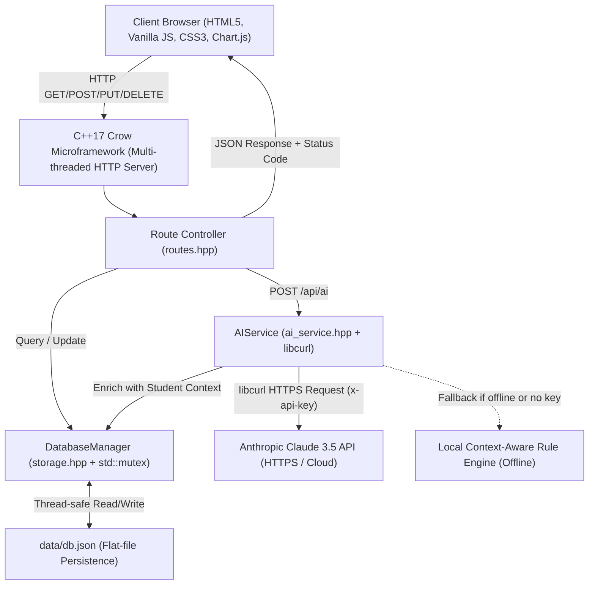

# 🎓 Student Survival Kit (SSK) — Project Viva & Defense Guide
> **Comprehensive Viva Preparation, Architecture Analysis, and Examiner Q&A**  
> *College "Computing Aptitude" Project Submission*

---

## 1. ⏱️ 30-Second Elevator Pitch (Memorize this for Opening)

> *"Respected Examiners, **Student Survival Kit** is a full-stack academic productivity platform designed to solve the critical organizational challenges college students face every semester.  
> The backend is built in **modern C++17** using the **Crow microframework**, delivering microsecond response times and thread-safe atomic data persistence in a local JSON database without bulky external database engines.  
> For intelligence, our C++ backend leverages **libcurl** to securely connect to the **Anthropic Claude 3.5 API**, passing real-time student context—including attendance shortages and pending lab assignments—to generate custom revision timetables and weekly briefings.  
> The frontend is crafted in **pure Vanilla HTML5, CSS3, and JavaScript**, featuring a modern glassmorphic dark/light UI, interactive Chart.js visualizations, real-time exam countdown clocks, and a mathematically derived 75% attendance bunk/recovery calculator."*

---

## 2. 🏛️ System Architecture & Data Flow

---

## 3. 💡 Why C++17 & Crow for the Backend?

Examiners frequently ask: *"Why C++ instead of Python (Django/Flask) or Node.js (Express)?"*

Here are the four pillars to explain:
1. **Unrivaled Performance & Zero Runtime Overhead**:
   - Node.js and Python require massive runtimes (V8 engine or Python interpreter) consuming 150MB–300MB of RAM just to idle.
   - Our compiled C++ Crow binary operates in **under 15MB of RAM**, with request latency measured in **microseconds** rather than milliseconds.
2. **True Native Multithreading**:
   - Python suffers from the **Global Interpreter Lock (GIL)**, restricting execution to a single CPU core.
   - Crow is built on top of **standalone Asio** (Boost.Asio), utilizing an asynchronous I/O thread pool. Each incoming request is handled concurrently across hardware worker threads without blocking the main event loop.
3. **Type Safety & C++17 Modern Idioms**:
   - We utilize strong typing, `std::optional` for nullable query results, `std::clamp` for bounds checking, and `nlohmann::json` for type-safe serialization.
   - Resource Acquisition Is Initialization (**RAII**) guarantees that files, network sockets, and memory buffers are freed deterministically with zero memory leaks.
4. **Systems Engineering Competence**:
   - Building a REST API in C++ demonstrates deep understanding of low-level networking, HTTP protocol headers, memory management, and cross-platform compilation.

---

## 4. 🧮 Mathematical Formulations Deep-Dive

Examiners love mathematical rigor. Be prepared to explain these two formulas on the whiteboard:

### A. The 75% Attendance "Bunk Calculator" ($\ge 75\%$)
When a student has good attendance, they want to know: *"How many future classes $x$ can I skip and still stay above 75%?"*

**Derivation:**
$$\frac{\text{Attended}}{\text{Total} + x} \ge \frac{75}{100} = 0.75$$

Multiply both sides by $(\text{Total} + x)$:
$$\text{Attended} \ge 0.75 \times \text{Total} + 0.75 \times x$$
$$0.75 \times x \le \text{Attended} - 0.75 \times \text{Total}$$
Multiply by 100:
$$75 \times x \le (100 \times \text{Attended}) - (75 \times \text{Total})$$
$$x \le \frac{100 \times \text{Attended} - 75 \times \text{Total}}{75}$$

Because classes are discrete integers, we apply the **floor** function:
$$\boxed{x = \left\lfloor \frac{100 \times \text{Attended} - 75 \times \text{Total}}{75} \right\rfloor}$$

*Example: 28 attended out of 32 total classes.*
$$x = \left\lfloor \frac{2800 - 75 \times 32}{75} \right\rfloor = \left\lfloor \frac{2800 - 2400}{75} \right\rfloor = \left\lfloor \frac{400}{75} \right\rfloor = \lfloor 5.33 \rfloor = \mathbf{5 \text{ classes can be skipped!}}$$

---

### B. The 75% Attendance "Recovery Calculator" ($< 75\%$)
When attendance drops below 75%, the student needs to know: *"How many consecutive upcoming classes $y$ must I attend to recover to 75%?"*

**Derivation:**
$$\frac{\text{Attended} + y}{\text{Total} + y} \ge \frac{75}{100} = 0.75$$

Multiply both sides by $(\text{Total} + y)$:
$$\text{Attended} + y \ge 0.75 \times \text{Total} + 0.75 \times y$$
$$(1.0 - 0.75) \times y \ge 0.75 \times \text{Total} - \text{Attended}$$
$$0.25 \times y \ge 0.75 \times \text{Total} - \text{Attended}$$
Multiply by 100:
$$25 \times y \ge 75 \times \text{Total} - 100 \times \text{Attended}$$
$$y \ge \frac{75 \times \text{Total} - 100 \times \text{Attended}}{25}$$

Because the student must attend full classes, we apply the **ceiling** function:
$$\boxed{y = \left\lceil \frac{75 \times \text{Total} - 100 \times \text{Attended}}{25} \right\rceil}$$

*Example: Operating Systems — 21 attended out of 30 total classes (70.0%).*
$$y = \left\lceil \frac{75 \times 30 - 100 \times 21}{25} \right\rceil = \left\lceil \frac{2250 - 2100}{25} \right\rceil = \left\lceil \frac{150}{25} \right\rceil = \mathbf{6 \text{ consecutive classes must be attended!}}$$

---

### C. Composite Productivity Score Formula
The productivity score (0–100) integrates three aspects of academic health:
$$\text{Productivity} = 0.40 \times T_{\text{rate}} + 0.35 \times A_{\text{rate}} + 0.25 \times \min\left(100, \frac{\text{Att}_{\text{overall}}}{75} \times 100\right)$$
- $T_{\text{rate}}$: Percentage of today's tasks completed.
- $A_{\text{rate}}$: Percentage of assignments done or in-progress.
- $\text{Att}_{\text{overall}}$: Aggregate attendance health normalized against the 75% goal.

---

## 5. 🤖 How the AI Integration Works (libcurl + Claude 3.5)

1. **Security**: The Anthropic API key is read via `std::getenv("ANTHROPIC_API_KEY")`. It is **never** transmitted to the client, never logged, and never stored in frontend code.
2. **Context Enrichment**: When the student asks a question (e.g., *"What should I study today?"*), the C++ backend intercepts the prompt, serializes the current student state from `DatabaseManager` into JSON, and prepends it to the Claude system prompt.
3. **libcurl Pipeline**:
   - `curl_easy_init()` allocates a handle.
   - Sets headers: `x-api-key`, `anthropic-version: 2023-06-01`, and `Content-Type: application/json`.
   - Sends payload to `https://api.anthropic.com/v1/messages`.
   - A static memory callback appends received chunks into a `std::string` buffer.
   - `nlohmann::json::parse()` extracts `response["content"][0]["text"]`.
4. **Smart Offline Fallback**: If the API key is not set or network connectivity drops during the presentation, our backend triggers an internal rule-based inference engine. It inspects the actual subjects, exam dates, and attendance figures to generate structured, markdown-formatted study timetables so the live demonstration **never crashes**.

---

## 6. 💬 Top 10 Viva Questions & Model Answers

### Q1: "What design pattern did you use for the Database and AI service?"
> **Answer**: *"We utilized the **Singleton Pattern** for both `DatabaseManager` and `AIService`. By ensuring a single static instance accessed via `.getInstance()`, we guarantee that all multi-threaded Crow worker threads read and write to the same synchronized memory cache, guarded by a `std::mutex` lock to prevent race conditions."*

### Q2: "Why choose flat JSON file storage instead of SQLite or MySQL?"
> **Answer**: *"For a personal student desktop command center, a flat JSON file on disk provides zero setup overhead, zero external database daemon dependencies, human readability for inspection and grading, and instantaneous startup. We implement thread safety using `std::mutex` and atomic writes."*

### Q3: "How do you handle CORS and static asset delivery in Crow?"
> **Answer**: *"In `include/routes.hpp`, our helper function `makeJsonResponse()` automatically attaches standard CORS headers (`Access-Control-Allow-Origin: *`, `Access-Control-Allow-Methods`, and `Access-Control-Allow-Headers`). Preflight `OPTIONS` requests are handled with HTTP 204. Static files (`index.html`, `style.css`, `app.js`) are served using binary file streams with automatic MIME type detection."*

### Q4: "How does the drag-and-drop daily task reordering work?"
> **Answer**: *"In the frontend, we utilize standard HTML5 Drag-and-Drop API events (`dragstart`, `dragover`, `drop`). When the user drops a task card, the new DOM order is collected into an array of IDs and dispatched via `POST /api/tasks/reorder`. The backend updates the `order` attribute and persists `db.json`."*

### Q5: "What happens if a user submits invalid or incomplete JSON to an API?"
> **Answer**: *"All POST and PUT endpoints wrap parsing in `try/catch (const std::exception& e)` blocks. We validate required fields (like `title` or `subject`). If validation fails, we return `HTTP 400 Bad Request` with a JSON payload `{"error": "..."}` rather than crashing the server."*

### Q6: "How did you implement the live exam countdown clock?"
> **Answer**: *"In `app.js`, a 1-second `setInterval` loop computes the delta between `new Date().getTime()` and the target examination timestamp `date + 'T' + time`. It extracts Days, Hours, Minutes, and Seconds using modulo arithmetic and updates the DOM flip-cards smoothly without re-rendering the whole page."*

### Q7: "How is the modern dark theme implemented?"
> **Answer**: *"We use CSS Custom Properties (`--bg-primary`, `--bg-glass`, `--accent-indigo`, etc.) bound to `:root`. When the user toggles the theme button, JavaScript toggles the `data-theme='light'` attribute on the `<html>` root element and stores the preference in `localStorage` so it persists across sessions."*

### Q8: "How does the frontend communicate with Chart.js?"
> **Answer**: *"Chart.js is loaded via CDN. In `app.js`, `renderAttendanceChart()` extracts subject codes and attendance percentages from our state. It binds to the `<canvas>` element and draws a bar chart color-coded green for $\ge 75\%$ and red for $< 75\%$."*

### Q9: "What is RAII in C++ and where is it used in your code?"
> **Answer**: *"RAII stands for Resource Acquisition Is Initialization. We use it in `std::lock_guard<std::mutex> lock(m_mutex)`. When `lock` is created on the stack, it acquires the mutex; when the enclosing function exits, its destructor automatically unlocks the mutex, guaranteeing thread safety even if an exception occurs."*

### Q10: "If you had another month, what features would you add next?"
> **Answer**: *"We would add WebSockets for live peer study rooms, OAuth2 login with Google/GitHub, and PDF syllabus parsing using an OCR library so assignments and exam dates are automatically imported from college course handouts."*
